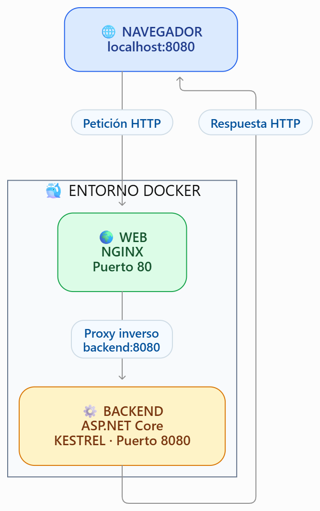

# NovaHarvest

## 1. Arranque

### Ejecutar con Docker

Para iniciar NovaHarvest, abrimos una terminal en la carpeta principal del proyecto y ejecutamos:

```bash
docker compose up -d --build
```

Para comprobar que los contenedores están funcionando:

```bash
docker compose ps
```

Accedemos a la aplicación desde el navegador:

- **Inicio:** [http://localhost:8080/](http://localhost:8080/)
- **Acerca de:** [http://localhost:8080/about](http://localhost:8080/about)
- **Estado del servidor:** [http://localhost:8080/status](http://localhost:8080/status)
- **Hoja de estilos:** [http://localhost:8080/css/site.css](http://localhost:8080/css/site.css)
- **Logotipo:** [http://localhost:8080/img/logo.png](http://localhost:8080/img/logo.png)

Para detener los contenedores:

```bash
docker compose down
```

### Ejecutar sin Docker

Entramos en la carpeta del backend:

```bash
cd backend/NovaHarvest.Web
```

Ejecutamos la aplicación:

```bash
dotnet run
```

La aplicación se ejecuta directamente mediante Kestrel. Para acceder a ella, utilizamos la dirección que aparece en la terminal al iniciar el servidor.

Para detenerla, pulsamos `Ctrl + C`.

## 2. Arquitectura

NovaHarvest utiliza Nginx como proxy inverso y ASP.NET Core como backend.

El navegador envía las peticiones a Nginx, que las recibe por el puerto 80 del contenedor web, publicado en el puerto 8080 del equipo. Después, Nginx reenvía las peticiones al backend mediante el puerto 8080 de la red interna de Docker.

El backend utiliza ASP.NET Core y Kestrel para procesar las peticiones y generar las páginas HTML.

### Diagrama de arquitectura



### Recorrido de una petición

1. El usuario introduce una dirección en el navegador.
2. Nginx recibe la petición a través del puerto 8080 del equipo.
3. Nginx reenvía la petición al backend por la red interna de Docker.
4. Kestrel procesa la petición y ejecuta el código C# correspondiente.
5. El backend devuelve la respuesta a Nginx.
6. Nginx entrega la respuesta al navegador.